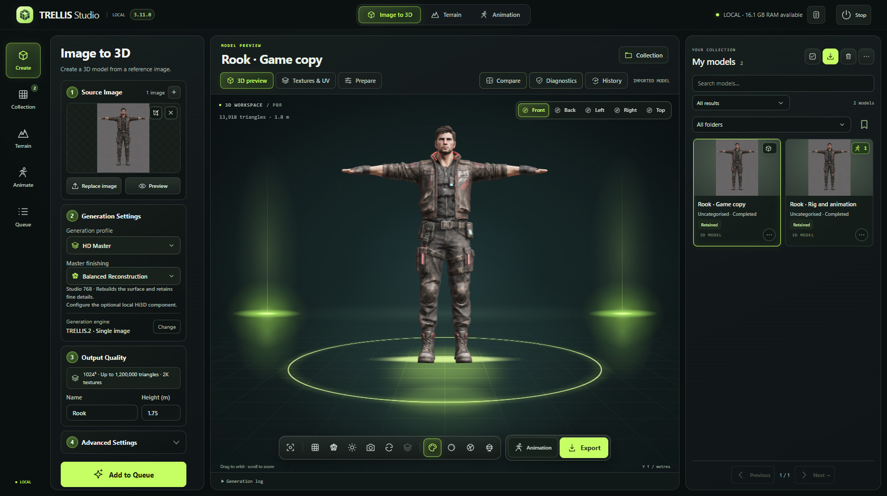
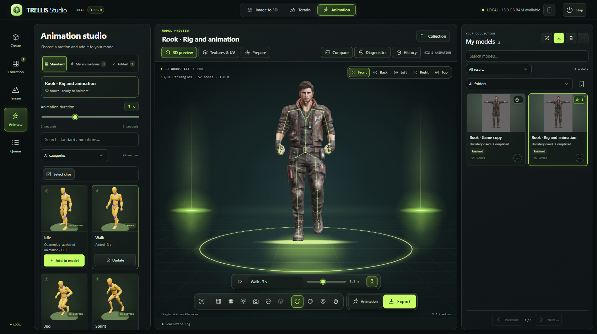

<p align="center"></p>
<h1 align="center">TRELLIS Studio</h1>
<p align="center">Un atelier local pour créer, préparer, équiper d’un squelette et animer des modèles 3D.</p>
<p align="center"><a href="README.md" lang="en">English</a> · <strong>Français</strong></p>
<p align="center"><a href="LICENSE">MIT · Code de Studio</a> · <a href="INSTALLATION.md">Installation</a> · <a href="docs/API.md">API REST</a> · <a href="docs/MCP.md">MCP</a> · <a href="THIRD_PARTY_NOTICES.md">Crédits et licences</a></p>

TRELLIS Studio est une application communautaire indépendante qui s’appuie sur **Microsoft TRELLIS.2** et **UniRig**. Elle permet de générer un maillage texturé à partir d’une image, d’importer un modèle existant, de l’inspecter dans une visionneuse PBR et de le préparer pour Blender, Unity, Unreal Engine ou l’impression 3D.

Les calculs s’exécutent sur la machine qui héberge Studio, où restent les images de référence et les modèles. **Desktop** est destiné à un seul utilisateur. **Server** donne à chaque compte approuvé sa propre bibliothèque et permet un accès par le réseau local ou par un domaine avec HTTPS.

## Interface en français

Le sélecteur de langue dans l’en-tête permet de choisir **Français** ou **English**. Studio démarre en français si c’est la langue préférée de ton navigateur. Il mémorise ensuite ton choix dans ce navigateur.

Cette version du fork est basée sur **TRELLIS Studio 3.15.1**. Elle intègre le graphe de génération, la finition multivue, UltraTex 2K et les nouveaux outils de la collection et des créatures. [Notes de version](docs/RELEASE_3.15.1.md) · [Profils de génération autonomes](docs/NATIVE_PROFILES.md)

## Démo en 30 secondes

[](docs/demo/compressor-to-unity.mp4?raw=true)

Une seule génération a produit deux variantes, toutes deux avec des textures PBR 2K. La version détaillée compte **94 170 triangles** et la version jeu **27 568 triangles**. La vidéo montre l’import du FBX allégé et de ses matériaux dans Unity 6. [Vidéo HD (MP4)](docs/demo/compressor-to-unity.mp4?raw=true)

## Installer la version française sur Windows

Ce fork cible **Windows x64**. Pour installer cette version, télécharge [l’archive ZIP de la branche Créature](https://github.com/Loomaknox/TRELLIS-Studio/archive/refs/heads/feat/creature-rig.zip) ou clone cette branche avec Git. Les exécutables disponibles dans les [versions du projet d’origine](https://github.com/yoslo59/TRELLIS-Studio/releases) sont publiés par son mainteneur.

```powershell
git clone --branch feat/creature-rig https://github.com/Loomaknox/TRELLIS-Studio.git
cd TRELLIS-Studio
```

1. Installe **Node.js LTS x64, version 22 ou supérieure**, avec npm. Installe **Blender** pour les conversions, la préparation et les exports qui en ont besoin. Pour UniRig, prépare **WSL2 avec Ubuntu 22.04** et termine l’initialisation du compte Linux. [Prérequis détaillés](INSTALLATION.md#prerequisites)
2. Exécute **Install TRELLIS Studio.cmd** dans le dossier cloné. Lis les conditions des modèles, dont DINOv3, et accepte uniquement celles auxquelles tu consens.
3. Exécute **Open TRELLIS.cmd**. Depuis les sources, Studio écoute par défaut sur [127.0.0.1:7860](http://127.0.0.1:7860/) et le pont MCP Desktop sur le port **7861**. Les ports par défaut du paquet Windows sont **7870** et **7871**.

La configuration de référence du projet d’origine est Windows 11 avec une NVIDIA RTX 4070 Ti et 12 Go de VRAM. Le guide d’installation depuis les sources recommande **32 Go de RAM** et **80 Gio d’espace libre** pour une installation complète, auquel s’ajoute l’espace utilisé par ta collection et par les options installées. La génération TRELLIS.2 fonctionne dans l’environnement Windows, et UniRig s’exécute dans un environnement WSL2 séparé. [Installation et dépannage](INSTALLATION.md)

| Composant | Quand l’utiliser | Configuration |
| --- | --- | --- |
| **UniRig** | Prédire le squelette et les poids d’un personnage en pose A ou T. | Ubuntu 22.04 dans WSL2. Voir le [guide Blackwell](docs/BLACKWELL_SETUP.md) pour les RTX 50 et la [configuration GPU](docs/WINDOWS_SETUP.md#gpu-profiles) du programme d’installation Windows. |
| **Pixal3D** | Générer depuis une image ou depuis une vue de face et jusqu’à trois vues complémentaires. | Lance **Install Pixal3D.cmd** pour la génération multivue. L’option `--single-image` ajoute les composants nécessaires à la génération avec une seule image. [Installation de Pixal3D](INSTALLATION.md#optional-pixal3d-generation) |
| **Hi3D** | Affiner les détails d’une source compatible créée avec TRELLIS.2. | GPU NVIDIA compatible et environ **10,66 Go** de poids supplémentaires après acceptation de la licence. [Compatibilité et installation](docs/HI3D.md) |
| **WTiVo 1024** | Reconstruire la surface d’un modèle HD à partir d’une source compatible. | Moteur WTiVo facultatif et Blender. Studio propose aussi sa reconstruction intégrée sur grille 768. [Guide WTiVo](docs/WTIVO.md) |
| **UltraTex 2K Preview** | Calculer de nouvelles vues de texture et les projeter sur l’atlas 2K d’un modèle compatible. | Minimum 12 Gio de VRAM, environ 14 Go de poids et acceptation des conditions FLUX.2. [Guide UltraTex](docs/ULTRATEX.md) |
| **Kimodo** | Générer des mouvements humanoïdes en décrivant une action. | Calcul sur CPU avec AVX2, FMA et F16C, WSL2 initialisé, **12 Gio libres dans WSL** et environ **9,3 Go** de poids supplémentaires. [Guide Kimodo](docs/MOTION_GENERATION.md) |

Pour une installation empaquetée, le projet d’origine documente les modes Desktop et Server, les réparations et la désinstallation. [Programme d’installation Windows](docs/WINDOWS_SETUP.md) · [Configurer TRELLIS Server](docs/SERVER.md)

## Utiliser Studio



- **Créer.** Génère un modèle depuis une image, ajuste le détourage et choisis un profil de génération. Le profil maître HD conserve une source réutilisable pour comparer plusieurs finitions. La file d’attente permet de regrouper jusqu’à 30 images.
- **Importer et contrôler.** Importe un GLB, FBX, OBJ, STL ou PLY autonome jusqu’à 500 Mo. Vérifie la topologie, les UV, les matériaux, les dimensions et les animations. Compare les variantes avec la même caméra et organise ta collection avec des dossiers, des filtres et des étiquettes.
- **Préparer.** Projette les couleurs de référence sur un GLB statique compatible, crée une variante jeu avec des textures recalculées depuis le modèle HD, ajoute des niveaux de détail (LOD) ou règle le pivot et les collisions. Pour l’impression, crée une copie dédiée et vérifie le résultat dans ton logiciel de tranchage.
- **Présenter et sauvegarder.** Enregistre une miniature, exporte une image PNG transparente ou une vue tournante et sauvegarde la collection au format ZIP. Les variantes restent liées à leurs modèles sources.

### Personnages et animation



1. Sélectionne un personnage et ouvre l’espace d’animation. S’il est déjà équipé d’un squelette, Studio peut conserver le squelette et les clips intégrés à son GLB.
2. Pour ajouter un squelette, oriente le personnage de face et positionne les repères du menton, des épaules, des coudes, des poignets, de l’entrejambe, des genoux et des chevilles. Après le calcul UniRig, inspecte les articulations, les mains et les pieds sur la copie créée.
3. Ajoute plusieurs des **84 animations humanoïdes standard** de Quaternius au même modèle ou utilise des mouvements enregistrés dans ta bibliothèque si tu as configuré Kimodo. L’atelier permet de raccourcir les clips, de travailler les boucles et de choisir entre un mouvement sur place et un déplacement de la racine.
4. Vérifie les déformations, les appuis des pieds et les contacts avec les objets sur le personnage final. Le contrôleur qui enchaîne les clips en jeu se règle dans le projet Unity ou Unreal.

Lorsque les **profils de squelette** sont activés, **Auto** utilise le parcours UniRig actuel. **Simple** garde 22 os corporels et des mains rigides. **Standard** utilise 52 os sur un maillage aux doigts séparés. **Avancé** ajoute deux os de torsion des avant-bras et propose de choisir le type de mains, pour un total de 24 ou 54 os. Les repères restent ajustables. Chaque profil crée une variante liée à sa source vérifiée et peut recalculer les clips standard du modèle sélectionné.

Le profil expérimental **Expert** ajoute 25 os pondérés aux jambes et au bassin, aux bras et aux épaules, ainsi qu’au tronc. Il utilise 49 os avec mains rigides ou 79 avec doigts articulés. Les auxiliaires suivent une partie des rotations des articulations dans les clips standard.

Le profil expérimental **Expressif** ajoute 16 os corporels à Expert, pour 65 os avec mains rigides ou 95 avec doigts articulés. Il répartit la torsion à un tiers et deux tiers des bras, avant-bras, cuisses et tibias. Il ajoute des correctifs près des omoplates, de la cage thoracique, des hanches et de la voûte plantaire. Les positions sont calculées à partir des proportions et des axes du personnage. La même hiérarchie avec les mêmes options s’applique aux différentes morphologies. [Placement des correctifs corporels](https://dev.epicgames.com/documentation/metahuman/metahuman-stylized-character-body-rig-editing)

Dans Studio Desktop, ouvre **Animation → Ajouter un squelette → Créature** sur un maillage sans squelette. UniRig propose des os adaptés au maillage. L’aperçu 3D permet de déplacer leurs extrémités, de scinder un os et d’ajouter ou retirer des chaînes avant le calcul des poids. Les boucles de test couvrent la déformation, la foulée quadrupède, l’ondulation serpentine et le battement d’ailes. La variante finale reprend la hiérarchie éditée et s’exporte en GLB ou FBX animé.

Pour une méduse, choisis **Adapter les tentacules** dans l’éditeur du squelette. TRELLIS mesure les courbes dans le maillage, puis propose un nombre d’os par tentacule selon l’espacement choisi. Le tableau indique les longueurs et le nombre d’os par chaîne. Tu peux ajuster le résultat avant de lancer le calcul des poids. Lorsque le maillage rend certains tentacules difficiles à suivre, l’éditeur signale les estimations à vérifier.

Le panneau **Nage de méduse** règle la durée de la boucle, le nombre de pulsations, l’amplitude de l’ombrelle, l’ondulation des tentacules, le retard de propagation et le déplacement vertical. **Appliquer et lire la nage** génère et joue le clip directement dans TRELLIS. Tu peux le réappliquer sur le même modèle. Les réglages sont enregistrés dans le GLB avec le clip et les autres animations sont conservées.

Pour une validation locale, démarre le service Desktop avec la liste `TRELLIS_RIG_PROFILES`, par exemple `simple,standard,advanced,expert,expressive`. Le mode Serveur utilise `TRELLIS_SERVER_RIG_PROFILES`. Arrête puis redémarre le service après chaque changement de liste. Une liste vide masque les nouveaux profils. Les variantes existantes restent consultables et exportables.

### Exporter

| Destination | Contenu |
| --- | --- |
| **GLB portable** | Maillage, matériaux PBR, squelette et clips intégrés lorsque présents. |
| **Blender** | Fichier `.blend` éditable, GLB original et textures. |
| **Unity** | FBX animé, textures PBR, importateur Editor facultatif et ressources LOD ou collisions selon la préparation. |
| **Unreal Engine** | FBX animé, textures ORM et cartes de normales DirectX. |
| **Impression 3D** | STL de la copie d’impression et rapport de topologie. |
| **Terrain Unity** | Carte de hauteur, textures et importateur Editor pour un terrain procédural créé dans Studio. |

Pour **Unity**, ajoute le dossier `Editor` livré avec le paquet d’export et utilise **Tools → TRELLIS Studio → Configure exported models**. L’outil configure les matériaux et les animations de type Generic. Les réglages de l’avatar Humanoid et de l’Animator Controller se font dans ton projet.

## API, données et mises à jour

- Le bouton **API & MCP** ouvre l’espace développeur. L’API REST v1 et MCP permettent de piloter les imports, la file d’attente, la préparation et les exports. [Référence REST](docs/API.md) · [Configuration MCP](docs/MCP.md)
- Les modèles sont stockés dans `outputs/` et la corbeille dans `trash/`. Les réglages sont dans `config/`. Les exports et journaux sont dans `exports/` et `logs/`. Les modèles IA et les environnements d’exécution sont téléchargés localement pendant l’installation.
- Avant de mettre à jour les sources, sauvegarde la collection depuis l’application. Pour restaurer un composant manquant ou reprendre un téléchargement interrompu, consulte le [guide d’installation et de dépannage](INSTALLATION.md).

## Crédits, licences et assistance

Le code de TRELLIS Studio est publié sous licence **MIT** par **[yoslo59](https://github.com/yoslo59)**. La localisation française est disponible dans le [fork Loomaknox](https://github.com/Loomaknox/TRELLIS-Studio). [Licence du code](LICENSE) · [Soutenir le projet d’origine](https://github.com/sponsors/yoslo59)

- **Microsoft TRELLIS.2** génère des modèles 3D à partir d’images. Le port Windows s’appuie sur les travaux d’Igor Aherne et d’andrakis. [TRELLIS.2](https://github.com/microsoft/TRELLIS.2) · [Port Windows](https://github.com/IgorAherne/TRELLIS.2-stableprojectorz) · [Fork andrakis](https://github.com/andrakis/TRELLIS.2-stableprojectorz)
- **UniRig** fournit la prédiction du squelette et des poids. Les animations standard et le mannequin de démonstration viennent de **Quaternius** sous licence CC0. [UniRig](https://github.com/VAST-AI-Research/UniRig) · [Quaternius UAL 1](https://quaternius.com/packs/universalanimationlibrary.html) · [Quaternius UAL 2](https://quaternius.com/packs/universalanimationlibrary2.html)
- Les modèles IA et les dépendances conservent leurs licences respectives. **DINOv3** a ses propres conditions d’utilisation. [Licence DINOv3](licenses/DINOv3-LICENSE.md) · [Crédits et licences des tiers](THIRD_PARTY_NOTICES.md)

Pour signaler une erreur de traduction, indique l’écran, la langue et le texte affiché. Pour un problème technique reproductible, indique la version de Windows, la carte graphique, la VRAM, l’étape qui échoue et un extrait du journal sans données sensibles. [Signaler un problème dans le fork](https://github.com/Loomaknox/TRELLIS-Studio/issues) · [Suivi du projet d’origine](https://github.com/yoslo59/TRELLIS-Studio/issues)
